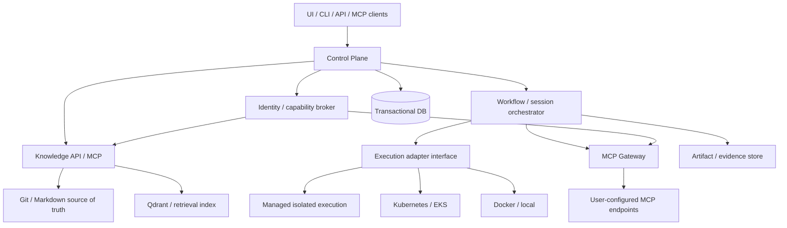

# RFC-0001 — Agentic Platform: architecture et contrats V1

| Champ | Valeur |
|---|---|
| Statut | **Draft — à revoir** |
| Version | 0.1 |
| Date | 2026-10-18 |
| Portée | Community (self-hosted), Enterprise (private), SaaS (managed) |
| Décision principale | Le produit orchestre des capacités déléguées dans des environnements isolés ; il n'impose ni modèles, ni MCP, ni politique métier |

## 0. Résumé exécutif

Construire une plateforme d'exécution d'agents et de workflows **indépendante du domaine métier**, des fournisseurs LLM et du backend d'exécution. Les organisations définissent leurs agents, leurs MCP, les actions déléguées et leurs contrats de qualité. La plateforme fournit les mécanismes techniques de **tenancy, isolation, délégation non extensible, exécution durable, observabilité et portabilité**.

Les connaissances pérennes appartiennent à des **Knowledge Spaces**, normalement liés à un projet ou autre périmètre métier, avec un stockage Markdown/Git comme source de vérité. Qdrant accélère la recherche ; son index reste reconstructible. Les informations vivantes (Jira, GitLab, Jenkins, SonarQube, cloud, messagerie, ERP…) sont obtenues **à la demande par des MCP autorisés**, sans être automatiquement stockées comme connaissances.

La plateforme prend en charge plusieurs **sessions/orchestrations indépendantes** en même temps. Le nombre de workers actifs est régulé globalement et par organisation, et non attaché à une unique orchestration.

## 1. Objectifs / non-objectifs

### Objectifs V1

1. Unifier Community, Enterprise et SaaS sur un même modèle de domaine et une même API.
2. Permettre à une organisation de fournir modèles, MCP, agents, Harness et images OCI.
3. Garantir qu'un sous-agent ne reçoit pas plus de permissions effectives que son parent.
4. Isoler organisations, workspaces, exécutions, secrets, données et accès aux connaissances.
5. Exécuter localement via Docker et à distance via Kubernetes avec des adapters.
6. Rendre les workflows reprenables après arrêt/restart des workers, avec événements et checkpoints.
7. Conserver la connaissance durable versionnée et sourcée, avec consultation hybride.
8. Offrir des workflows multi-agents sans imposer le cas d'usage du développement.
9. Fournir quelques images de base maintenues, plus une extension OCI libre.
10. Produire une suite de tests de séparation et de récupération comme critère de livraison.

### Non-objectifs V1

- Catalogue exhaustif d'agents ou d'images pour chaque métier.
- Définir à la place des utilisateurs quelles opérations métier sont autorisées.
- Remplacer Jira, GitLab, Jenkins, les ERP ou les sources transactionnelles.
- Indexer systématiquement les logs, états et tickets opérationnels dans le cerveau.
- Créer un outil de BI, un IDE ou un gestionnaire de secrets généraliste.
- Imposer Kubernetes à Community ou au SaaS en tant que contrat produit.
- Garantir qu'un LLM exécute correctement une action métier simplement parce qu'il a le droit de l'appeler.

## 2. Primitives de domaine

| Primitive | Définition et invariants |
|---|---|
| **Organization** | Tenant / périmètre de propriété, facturation et authentification. Aucun partage implicite entre organisations. |
| **Workspace** | Périmètre de collaboration ; références vers projets, Knowledge Spaces, agents, MCP et membres. N'est **pas** un volume filesystem. |
| **KnowledgeSpace** | Corpus documentaire durable, propriétaire, versionné ; ACL propres ; index dérivé ; peut être lié à plusieurs workspaces autorisés. |
| **AgentDefinition** | Définition immuable et versionnée : instructions, modèle, références de runtime, Harness et capacités demandées. |
| **ExecutionRuntime** | Profil d'exécution : image OCI, CPU/RAM/stockage, sandbox et backend adapter. Pas un Pod spécifique. |
| **AgentInstance** | Exécution concrète d'une version d'AgentDefinition dans un WorkflowRun/Session, avec identité et grant effectif. |
| **WorkflowDefinition** | Graphe/plan de tâches, conditions, délégations et critères de sortie ; versionné. |
| **WorkflowRun** | Instance durable d'un workflow avec événements, checkpoints, budgets et politique de reprise. |
| **Session** | Ensemble de conversations, contextes et exécutions liés à un sujet ; peut rester inactif sans conserver de CPU. |
| **HarnessDefinition** | Contrat de validation : assertions, tests, artefacts attendus et format des évidences ; facultatif selon le workflow. |
| **Evidence** | Preuve rattachée à une exécution, à une révision exacte et à un résultat de validation ; n'est pas une permission. |
| **McpConnection** | Connexion déclarée par le propriétaire, credentials référencés côté coffre, découverte des outils. |
| **CapabilityGrant** | Délégation bornée (MCP/outils, opérations, contexte, expiration, identité) ; accordée par un principal autorisé. |

**Convention :** les identifiants sont stables et opaques (`orgId`, `workspaceId`, `runId`…), et chaque ressource porte un `orgId` non modifiable. L'API ne fait jamais confiance à un `orgId` fourni isolément dans un payload pour prendre une décision d'accès.

## 3. Architecture logique



### Frontières de responsabilité

- **Control Plane** : organisations, workspaces, définitions, identités, sessions, politiques de délégation, quotas, scheduling et traçabilité.
- **Execution Plane** : démarrer/arrêter les runtimes et faire appliquer CPU, mémoire, réseau, filesystem et isolation ; ne détient pas de credentials utilisateurs en clair.
- **Knowledge Plane** : ingestion documentaire, versionnage, indexation, recherche et contributions validées.
- **Tool Plane** : accès aux MCP enregistrés, validation d'autorisation **à chaque appel**, broker des secrets et audit des actions.
- **Harness** : évalue les résultats produits ; ne remplace ni le contrôle d'accès ni l'isolation.

Un même déploiement peut regrouper physiquement ces services en quelques processus au départ. Les frontières **logiques** ne doivent pas disparaître.

## 4. Modèle de permissions et de délégation

### 4.1 Règle fondamentale

La plateforme **n'établit pas de politique métier universelle** : chaque organisation configure ses MCP, outils, scopes et restrictions. Elle garantit toutefois que les permissions accordées sont appliquées côté serveur.

Pour un enfant `C` délégué par `P` :

`Effective(C) ⊆ Requested(C) ∩ Effective(P) ∩ AllowedByWorkspace ∩ AllowedByOrganization`

Le grant effectif est **évalué à l'appel**, avec expiration, révocation, tenant, endpoint, tool name et éventuellement contraintes sur les arguments. Une délégation récursive ne peut pas élargir le périmètre. La modification d'une AgentDefinition ne crée pas de nouveaux droits.

### 4.2 Responsabilités

- **Administrateur/Utilisateur autorisé** : enregistre un MCP, consent à ses droits, sélectionne les capabilities, choisit le fournisseur LLM, fixe les budgets et les éventuelles approbations.
- **Plateforme** : authentifie le principal, stocke les secrets, applique les capabilities, isole les tenants et les exécutions, journalise les accès et applique la révocation.
- **MCP tiers** : demeure responsable de ses propres contrôles et comportements, sous réserve des garanties contractuelles du fournisseur.

### 4.3 Mesures non négociables

1. Aucun agent n'obtient directement des credentials maître de l'organisation : le MCP Gateway réalise les appels avec un credential approprié, idéalement temporaire ou scoped.
2. Les MCP distants et images OCI personnalisées sont des entrées **non fiables** ; le SaaS requiert egress contrôlé, blocage SSRF, validation des destinations et isolation renforcée.
3. Une permission `mcp:tool.invoke` ne donne pas de permission implicite `network:any` ou `secrets:read`.
4. Les annotations des outils MCP servent d'indications, pas d'autorité de sécurité : les règles appliquées sont celles du grant.
5. Les événements d'audit contiennent identités, run, outil, décision et référence d'artefact ; les secrets et charges utiles sensibles ne sont pas logués sans nécessité.
6. Les capacités non attribuées sont refusées par défaut ; l'identité de service et l'identité humaine sont distinguées.
7. Les agents avec terminal/code doivent être isolés du réseau de contrôle et du coffre ; ils ne peuvent pas court-circuiter la gateway pour atteindre des systèmes protégés.
8. Les garanties en local dépendent de la configuration de l'hôte ; aucune promesse d'isolation « SaaS-grade » pour un processus lancé avec tous les droits utilisateur.

**Limite explicite :** lorsque l'utilisateur autorise une destination externe à recevoir des données, la plateforme peut contrôler la destination, la portée et tracer l'appel, mais ne peut pas garantir l'absence de divulgation au destinataire autorisé.

## 5. Knowledge Space : connaissance durable, projet propriétaire

### Source de vérité

- Un repository Git de fichiers Markdown (compatible Obsidian) par projet ou périmètre documentaire, **pas nécessairement un repository applicatif par cerveau**.
- Contenu : architecture, fonctionnel, ADR, procédures durables, décisions passées, glossaire, contraintes et historique de validité.
- Métadonnées : `documentId`, `knowledgeSpaceId`, classification, version, révision Git, auteur/approbateur, date de validité, références sources.
- Modifications via PR/MR ou API de contribution avec contrôle concurrent (base revision).
- Révisions dépassées : marquées `superseded` ou `deprecated`, historiques conservés.

### Indexation et retrieval

- **Qdrant** est un index dérivé et remplaçable, sans dépendance pour exporter/restaurer le cerveau.
- Indexation incrémentale sur changements Git ; chunks par section Markdown avec IDs stables, hash, source lines et permissions.
- Recherche hybride **dense + sparse**, filtres serveur tenant/KnowledgeSpace, citations exactes et option de reranking.
- Contenu des chunks présent dans l'index pour ne pas relire le vault sur chaque recherche ; lecture du fichier source pour consultation complète ou vérification de version.
- Embeddings exécutés uniquement dans une destination explicitement autorisée par le propriétaire des données. Possibilité 100 % interne.
- Interdiction d'un fallback de recherche inter-tenant si aucun résultat n'est trouvé.
- Partage entre projets uniquement par ACL explicite ; jamais entre organisations par défaut.

### Distinction durable / volatile

| Durable : Knowledge Space | Volatile : MCP à la demande |
|---|---|
| ADR, règles métier validées, procédures, glossaire | Statut CI Jenkins, mesures SonarQube, état Kubernetes |
| Conclusions d'incidents et causes prouvées | Logs bruts, tickets en cours, statut d'incident |
| Contraintes contractuelles pérennes documentées | Secrets, tokens, listes de déploiements courants |

Une observation opérationnelle peut donner lieu à une **proposition de connaissance** sourcée et revue, jamais à une insertion automatique non contrôlée.

## 6. Agents : configuration distincte de l'image d'exécution

La plateforme maintient seulement quelques images officielles : `base`, `developer`, `browser` (profils optionnels, versionnés). Les organisations peuvent apporter une image OCI signée/approuvée selon leur politique. Les configurations d'agents sont versionnées et déclaratives.

```yaml
# Schéma conceptuel V1 ; ce n'est pas une CRD Kubernetes.
apiVersion: platform.example/v1
kind: AgentDefinition
metadata:
  name: java-developer
spec:
  # Le modèle reste choisi par l'organisation.
  modelRef: org-models/main-coding
  runtimeRef: runtimes/java-21
  instructionsRef: git://project/.agents/developer.md
  knowledgeSpaces:
    - project-knowledge
  requestedCapabilities:
    - tool: gitlab.read_repository
    - tool: gitlab.push_branch
    - tool: knowledge.search
  harnessRef: java-integration
```

Le runtime ne possède **pas** les credentials associés à `requestedCapabilities` ; il obtient une identité d'exécution et des appels via la Gateway. `requestedCapabilities` ne constitue pas un grant en soi.

## 7. Sessions et workflows indépendants

Un utilisateur peut lancer plusieurs sujets en parallèle. Chaque sujet possède ses propres sessions, budgets, workers, checkpoints et workspaces filesystem. Un scheduler applique les quotas au niveau global, organisation, workspace, run et runtime.

### États minimaux

- **Session** : `ACTIVE`, `IDLE`, `ARCHIVED` (IDLE n'implique aucune consommation CPU obligatoire).
- **WorkflowRun** : `QUEUED → RUNNING → (WAITING | COMPLETED | FAILED | CANCELLED)` ; `WAITING → RUNNING` après approbation, dépendance ou reprise.
- **AgentInstance** : `PENDING → STARTING → RUNNING → (SUCCEEDED | FAILED | CANCELLED)`.
- Reprise après crash via journal d'événements et checkpoints ; les opérations externes susceptibles d'être répétées doivent porter une clé d'idempotence ou être réconciliées.
- Le nombre maximum d'agents simultanés est un quota de capacité, **pas** un nombre d'agents fixé par workflow.

### Backend d'exécution

Interface : `start`, `inspect`, `logs`, `signal`, `stop`, `cleanup`, `capabilities`.

- **Community** : Docker/Compose ; exécuteur local facultatif avec limites de confiance explicites.
- **Enterprise** : Kubernetes avec NodePools, stockage et secrets choisis par l'administrateur ; cluster client possible.
- **SaaS** : backend managé sandboxé, sans cluster Kubernetes visible pour l'utilisateur.

L'API doit exposer les garanties supportées par chaque adapter, plutôt que prétendre que chaque backend offre la même isolation.

## 8. Cas « développement » : Git, Harness, intégration

Ce cas d'usage est un **module métier facultatif**, non le noyau du produit.

- Un repository est préparé par session ou pool local ; chaque worker modifiant le code possède une branche/worktree isolé quand ils partagent un même filesystem.
- Sur des nœuds indépendants, branches distantes et clones partiels peuvent être utilisés, sans exiger un filesystem partagé.
- Chaque worker livre commit(s), base commit, Harness result et références d'évidences.
- Un **Merge Controller déterministe** vérifie les preuves et tente le merge ; aucun LLM pour les merges ordinaires.
- Si conflit ou incompatibilité détectée : déclenche un agent intégrateur avec grant explicite et tests d'intégration/E2E ciblés.
- **Précaution :** des branches individuellement validées peuvent casser l'ensemble sans conflit Git. Une preuve de compatibilité avec la base d'intégration est nécessaire pour sauter une revalidation globale ; sinon, validation ciblée ou pipeline d'intégration.

## 9. Contrats API V1 (proposition)

### 9.1 Ressources et endpoints

| Méthode | Endpoint | Contrat |
|---|---|---|
| `POST` | `/v1/organizations/{orgId}/workspaces` | Créer un Workspace dans l'organisation autorisée. |
| `POST` | `/v1/workspaces/{id}/knowledge-spaces` | Attacher ou créer un corpus autorisé. |
| `POST` | `/v1/agent-definitions` | Publier une version immuable d'agent. |
| `POST` | `/v1/runtime-profiles` | Enregistrer un runtime autorisé. |
| `POST` | `/v1/mcp-connections` | Déclarer un MCP ; credentials via référence au coffre. |
| `POST` | `/v1/capability-grants` | Accorder un sous-ensemble des droits détenus. |
| `POST` | `/v1/workflows` | Publier une définition de workflow versionnée. |
| `POST` | `/v1/workflow-runs` | Démarrer une orchestration. |
| `GET` | `/v1/workflow-runs/{runId}` | État, coûts/quotas, tâches et références d'évidences. |
| `GET` | `/v1/workflow-runs/{runId}/events` | Flux d'événements reprenable (`cursor`). |
| `POST` | `/v1/workflow-runs/{runId}/cancel` | Annulation idempotente. |
| `POST` | `/v1/knowledge/search` | Recherche avec filtres de scope imposés côté serveur. |
| `POST` | `/v1/knowledge/contributions` | Proposer une modification versionnée. |

Les changements critiques (`grant`, `runtime`, `agent definition`) sont audités. Les requêtes de mutation supportent `Idempotency-Key` et renvoient un identifiant de ressource.

### 9.2 Exemple de création d'un workflow run

```json
{
  "workspaceId": "ws_aon_backend",
  "workflowDefinition": {
    "id": "wf_code_maintenance",
    "version": 3
  },
  "sessionId": "sess_20261018_a",
  "objective": "Identifier et corriger une régression",
  "limits": {
    "maxConcurrentAgents": 5,
    "maxCostUsd": 20
  },
  "capabilityGrantId": "grant_123"
}
```

La réponse renvoie `runId`, `state=QUEUED`, `createdAt` et une URL d'événements. L'API vérifie le droit de lancer le workflow dans le workspace ; elle n'accepte pas un grant arbitraire appartenant à une autre organisation.

### 9.3 Exemple de délégation d'un grant

```json
{
  "parentGrantId": "grant_123",
  "delegateTo": "agent_instance_456",
  "tools": ["gitlab.read_repository", "knowledge.search"],
  "constraints": {
    "workspaceId": "ws_aon_backend",
    "expiresAt": "2026-10-18T18:00:00Z"
  }
}
```

Le serveur calcule l'intersection avec les droits effectifs du parent, refuse toute extension et émet un grant éphémère révocable. La chaîne de délégation est conservée pour l'audit.

### 9.4 Recherche de connaissance

```json
{
  "query": "Pourquoi la rotation des nœuds perturbe RabbitMQ ?",
  "knowledgeSpaceIds": ["ks_aon_architecture"],
  "topK": 8,
  "mode": "hybrid"
}
```

Le serveur vérifie chaque `knowledgeSpaceId`, n'utilise jamais les IDs fournis comme filtre de sécurité suffisant et retourne `documentId`, `revision`, `section`, `lineRange`, `content`, `score` et un lien de consultation autorisé.

## 10. Stockage et portabilité

| Donnée | Support initial | Règle |
|---|---|---|
| Définitions / grants / états / événements | Base transactionnelle (PostgreSQL possible) | Source de vérité opérationnelle |
| Connaissances durables | Git + Markdown | Exportable et diffable sans service central |
| Index de recherche | Qdrant | Reconstructible à partir du dépôt documentaire |
| Artifacts / preuves | Stockage objet compatible S3 | Référence content-addressed ou avec hash |
| Credentials | Vault/KMS/external secret manager | Ne résident pas dans Qdrant ni dans les prompts |
| Session scratch/worktrees | Volume éphémère ou persistant par session | Jamais implicitement partagé entre tenants |

L'export d'un workspace doit inclure ses définitions portables, références documentaires et formats d'artefacts ; il **ne doit pas exporter silencieusement** les secrets ni les données appartenant à des MCP tiers.

## 11. Déploiement des éditions

| Sujet | Community | Enterprise | SaaS |
|---|---|---|---|
| Distribution | Docker Compose ; Kubernetes optionnel | Helm / GitOps / private cloud | Opérée par le fournisseur |
| Images agents | Officielles + OCI custom | Officielles + OCI approuvées | Socles officiels ; custom OCI dans sandbox dédiée si proposé |
| Knowledge | Git/Markdown + Qdrant local ou distant | Stockage/index conforme aux politiques clients | Isolation par tenant avec option dédiée |
| MCP | Choix de l'utilisateur | Choix de l'administrateur | Choix de l'utilisateur, filtrage SSRF/egress |
| Credentials | Stockage sécurisé configurable | Vault/KMS de l'entreprise | Secret broker du fournisseur |
| Isolation | Dépend de l'hôte et du backend | Selon environnement et niveau requis | Isolation renforcée des codes non fiables |
| Business model | Open source | Support/gouvernance/opérations | Usage + hébergement + services |

**Aucune édition ne réduit volontairement la sûreté des grants ou la séparation des organisations.** Les options avancées de gouvernance peuvent varier, pas l'application du contrôle d'accès fondamental.

## 12. Tests d'intégration et preuves V1

Priorité aux **tests bout-en-bout et de frontière**, pas à une prolifération de tests unitaires.

### Scénarios obligatoires

1. Deux organisations, même nom de Workspace : accès croisé à la mémoire, aux événements, aux artifacts et aux MCP **refusé**.
2. Deux projets dans la même organisation : recherche inter-projet refusée sans partage explicite.
3. Agent parent lecture seule → enfant demande écriture : délégation **refusée**.
4. Grant révoqué pendant un workflow : prochain appel MCP refusé, preuve et audit produits.
5. Reprise d'un run après suppression/restart du worker : état conservé, opération externe non répétée sans réconciliation.
6. Vingt AgentInstances réparties sur plusieurs sessions : quotas équitables, aucun partage de volumes/credentials entre workspaces.
7. Knowledge ingestion : mise à jour incrémentale, citations exactes, suppression logique et réindexation depuis Markdown.
8. MCP arbitraire : tentatives SSRF vers metadata service ou adresse interne bloquées sur le SaaS.
9. Image OCI non fiable : aucun accès au control plane ni aux secrets d'un autre tenant ; egress conforme au profil.
10. Module dev : branches validées, merge automatisé, conflit déclenche intégrateur, preuves reliées à chaque révision.

**Évidences** : logs corrélés par `runId`, résultats Harness, révisions Git, trace d'autorisation sans secrets, artefacts, latences et consommation CPU/RAM. Un échec d'isolation est un bloqueur de release.

## 13. Découpage d'implémentation

### V0 — Vertical slice démontrable

- API minimale `Organization`, `Workspace`, `AgentDefinition`, `CapabilityGrant`, `WorkflowRun`.
- Un runtime Docker local et un adapter Kubernetes (sur cluster existant) sans couplage dans le domaine.
- Une gateway MCP avec **un** outil read-only et **un** outil write autorisable, plus révocation.
- Un KnowledgeSpace Git/Markdown et Qdrant ; ingestion incrémentale et recherche citée.
- Deux organisations de test, plusieurs sessions concurrentes, mêmes noms de projet pour tenter les fuites.
- Tests E2E des dix frontières ci-dessus adaptées au périmètre livré ; démonstration d'un run repris après incident.

### V1 — Multi-projet/multi-utilisateur

- Authentification OIDC, RBAC de workspace, grants persistants, audit, modèles externes configurables.
- Orchestration de délégations et quotas globaux/par organisation ; preuves Harness.
- Multi-knowledge-space, flux de contribution contrôlé, export/import portable.
- Interface utilisateur pour configurer agents, MCP, runs, sessions, Knowledge Spaces.

### V1.1+ — Distribution

- SaaS : billing/metering, quotas, sandbox custom OCI, tenant scaling.
- Enterprise : déploiement privé, fédération d'identité, KMS, observabilité et politiques d'isolation configurables.
- Blueprints métiers, SDK, intégrations de catalogues MCP, marketplace éventuelle.

## 14. Risques et décisions ouvertes

| Point | Risque / décision à trancher | Proposition |
|---|---|---|
| Licence | Équilibre open source / offre commerciale | Étudier Apache-2.0 vs AGPL et politique de contributions avant publication |
| Orchestrateur durable | Éviter une réimplémentation fragile | Évaluer Temporal sur V0 contre un moteur event-sourced minimal |
| Isolation SaaS | Containers seuls insuffisants pour code arbitraire | Sandbox VM/microVM ou backend avec frontière équivalente, à valider par tests |
| Multi-tenancy Qdrant | Séparation logique ≠ isolation contractuelle | Filtre serveur obligatoire ; stockage dédié sur exigence contractuelle |
| Modèles / embeddings | Risque de transfert vers un fournisseur externe | Configuration explicite, hébergement interne possible, vérification egress |
| Données de preuve | Logs et artifacts potentiellement sensibles | Chiffrement, rétention configurable, classification et redaction |
| Agent engine | Éviter dépendance à un outil | Adapter OpenCode initial, autres engines ultérieurement |
| Object store | Preuves persistantes en modes local et cloud | Interface S3-compatible avec backend filesystem pour dev |
| Portabilité | Export sans secrets ni fuites | Format documenté des définitions et vaults ; migration testée |

## 15. ADR proposées

- **ADR-001** : séparation des plans Control / Execution / Knowledge / Tool.
- **ADR-002** : KnowledgeSpace « Git/Markdown source of truth ; Qdrant index dérivé ».
- **ADR-003** : grants explicitement délégués, non extensibles, appliqués par Gateway.
- **ADR-004** : définitions d'agents dissociées des runtimes OCI et des instances.
- **ADR-005** : moteurs d'exécution interchangeables ; Kubernetes backend, pas contrat produit.
- **ADR-006** : isolation tenant/workspace/run et modèle SaaS pour code non fiable.
- **ADR-007** : intégration logicielle déterministe avec Harness/evidence, agent intégrateur uniquement si besoin.

## 16. Critères d'acceptation de la RFC

La RFC peut passer de `Draft` à `Accepted` après validation de :

- [ ] Modèle de domaine et invariants de partage.
- [ ] Conditions exactes de délégation, révocation et audit.
- [ ] Isolation requise par édition, en particulier OCI utilisateur en SaaS.
- [ ] Contrat d'export/import et source de vérité documentaire.
- [ ] Choix du moteur de workflows pour le premier vertical slice.
- [ ] Spécification OpenAPI et contrats d'événements versionnés.
- [ ] Plan de tests E2E négatifs obligatoire avant exposition multi-tenant.

## Références techniques

1. MCP, changements de spécification 2026 : https://blog.modelcontextprotocol.io/posts/2026-07-28/
2. Kubernetes, multi-tenancy et limites d'isolation : https://kubernetes.io/docs/concepts/security/multi-tenancy/
3. Qdrant, multi-tenancy : https://qdrant.tech/documentation/manage-data/multitenancy/
4. Qdrant, hybrid queries : https://qdrant.tech/documentation/search/hybrid-queries/
5. Temporal, durable workflows : https://github.com/temporalio/documentation/blob/main/docs/evaluate/understanding-temporal.mdx

---

**Statut de travail :** RFC destinée à fixer les contrats et frontières ; les schémas JSON/YAML présentés sont conceptuels et ne constituent pas encore une implémentation ni un OpenAPI validé.