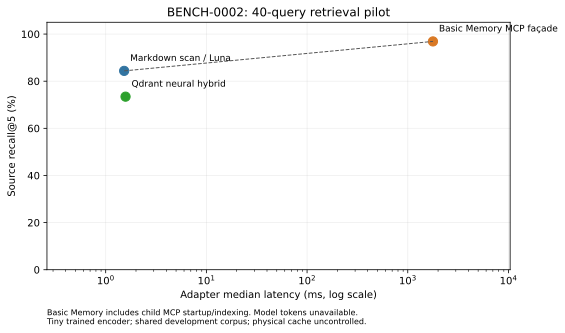

# BENCH-0002 — measured semantic pilot

The retrieval pilot completed 40 questions each for scoped Markdown, Qdrant neural hybrid and a real Basic Memory MCP façade. Cognee add-only ingestion and its offline tokenizer were repaired; Cognee graph/vector indexing and Graphiti extraction remain blocked without a capable local extraction LLM. The E lane records real native Luna submissions but has protocol failures and incomplete prompt/timing coverage. It cannot establish causal answer-quality or token savings. No production engine selection is supported.

## Frozen workload and scope

Seed 20261018; 80 synthetic bilingual notes, two organizations and ten projects. Corpus SHA-256 `05f2501f7e0369a432051f7e4d028f5e71133649f012171695145be51c761885`; 40-question SHA-256 `ce9a1eb825ddcba22998ef689fcfae3ee32ca173b49506e297791e2e11022e81`. Implementations and weights were frozen before an independent native author wrote the questions. Expected answers were exported only after E submissions closed. All 189 V1 tracked files retain their original bytes.

The R set has eight questions each for semantic paraphrase, multihop, temporal decisions, revisions and negatives, with 20 FR/20 EN questions across all ten scopes. The negative set actually has two missing-fact and six foreign-scope requests. The fixed 20 E IDs cover five scopes, ten FR/ten EN, four questions per category, two historical/two current temporal and two unknown/two foreign negatives. Sem-02 has a faulty command-preservation premise; gold accepts the documented circuit-breaker behavior correcting that premise. Revisions are represented by current r2 notes mentioning withdrawn r1 instructions; the pilot is not a longitudinal update stream.

**NON_BLIND_DEVELOPMENT**: all implementation workers share the filesystem. Gold was withheld procedurally; no OS/provider access boundary was demonstrated. Source facts are public. This is not evidence of unbiased generalization.

## Engines actually exercised

| Engine | Exercised integration | Remaining boundary |
|---|---|---|
| Qdrant 1.15.1 embedded | Learned dense vectors + sparse TF hashing + RRF; 40 real searches | Tiny locally trained EN/FR encoder, not pretrained; no dense-only ablation; superseded notes excluded |
| Basic Memory 0.13.1 | Real SyncService/FTS5 behind FastMCP 2.14.4 and official MCP SDK 1.26.0 stdio initialize/discovery/invocation | Custom façade; upstream CLI/MCP entry point remains unverified; fresh child/index per search |
| Direct Markdown | Deterministic bounded lexical scan in R; fresh native Luna in E | No index; same scoped list/read/search API |
| Cognee 0.5.1 / Kuzu 0.11.3 / LanceDB 0.40.0 | Offline canonical cl100k asset, real eight-note add, native dataset name/ID and persisted provenance verified | Add-only LLM connectivity probe explicitly skipped; cognify graph/vector extraction/indexing and retrieval blocked |
| Graphiti Core 0.17.9 | Actual shared neural checkpoint inference; native add_episode/search_ path and temporal filters implemented | Genuine extraction/temporal integration skipped: no capable local LLM weights/runtime |

Shared encoder: 128D learned token embeddings, mean pooling and learned 384D projection, L2 normalized; PyTorch 2.5.1+cpu, seed 20261018, 500 contrastive epochs on 40 public EN/FR pairs, 323-token vocabulary. Checkpoint SHA-256 `db50044db53237fb6f280a7b0c27eb0be45ff18f7108bcd61ea24640cbb15daf` was reproduced by a second training run. Unseen words map to zero. The official pretrained distribution was denied HTTP403 by the managed proxy; no alternate proxy or paid inference provider was used. These vectors are genuinely learned, with very limited generalization.

## Retrieval lane

| Engine | Recall@5 | Precision returned ≤5 | Fixed P@5 | MRR@5 | All sources | Negative empty | Obsolete hits | Adapter p50 / p95 ms | Guarded p50 ms |
|---|---:|---:|---:|---:|---:|---:|---:|---:|---:|
| Markdown scan / Luna | 84.4% | 21.3% | 21.3% | 0.649 | 81.2% | 0.0% | 23 | 1.525 / 1.767 | 8.237 |
| Qdrant neural hybrid | 73.4% | 18.8% | 18.8% | 0.483 | 68.8% | 0.0% | 0 | 1.574 / 2.121 | 8.754 |
| Basic Memory MCP façade | 96.9% | 24.4% | 24.4% | 0.738 | 96.9% | 0.0% | 8 | 1778.798 / 2352.102 | 1786.530 |

Source recall, both precision definitions and MRR are macro-averaged over 32 answerable questions. Multihop requires both exact source/revision pairs. Negatives are evaluated separately. Historical source 040 is valid for historical questions; otherwise a 040 hit is counted obsolete. This count includes irrelevant historical hits, not merely wrong answers. All 120 result sets passed scope, revision and corpus-integrity guards; no cross-scope result was observed. API safety and empty-hit behavior are distinct.

The guarded timer includes hashing the whole corpus before/after each search and checking returned revisions. Adapter latency excludes these outer guards. Basic Memory includes MCP child startup, private-copy sync and indexing in every adapter.search call. These paths differ materially; the table measures the implemented integrations. Module imports and full process startup are not included in factory timing.

| Engine | First-scope n / adapter p50 ms | Reused-scope n / adapter p50 ms | Factory setup total ms (10 scopes) | Parent process peak MiB |
|---|---:|---:|---:|---:|
| Markdown scan / Luna | 10 / 1.592 | 30 / 1.511 | 0.882 | 13.1 |
| Qdrant neural hybrid | 10 / 1.559 | 30 / 1.578 | 197.204 | 292.4 |
| Basic Memory MCP façade | 10 / 2259.863 | 30 / 1756.048 | 1.405 | 53.3 |

First/reused refers to adapter reuse, not physical cold/warm cache. No cache eviction was performed. RSS is a process lifetime high-water mark; Basic Memory child peak RAM is unavailable. CPU own/child deltas, kernel block-I/O counters, backend-reported source bytes and separate provenance-read overhead are retained in raw rows and resources.json. Block counters do not establish physical disk traffic.

## Native Luna E lane

Configured model/effort: `gpt-6-luna` / `medium`, fresh sessions, same requested JSON output, source/revision citations and maximum 12 wrapper operations. The served immutable snapshot and native token/tool counters are unavailable. Search calls use the candidate; scoped filesystem list/read is available identically to all. Native tools themselves are unrestricted, so the policy is not a capability sandbox.

| Engine | Submitted / planned attempts | Verified prompts | Passes / verified prompts | Pass rate on common 10 | Wrapper calls / errors | Returned body bytes |
|---|---:|---:|---:|---:|---:|---:|
| Markdown scan / Luna | 19 / 20 | 12 | 10 / 12 | 90.0% | 95 / 48 | 106767 |
| Qdrant neural hybrid | 20 / 20 | 13 | 11 / 13 | 90.0% | 90 / 55 | 82814 |
| Basic Memory MCP façade | 20 / 20 | 13 | 11 / 13 | 100.0% | 94 / 57 | 76820 |

Only captured prompts matching the frozen exact question, scope, capability digest, common policy and actual agent assignment are eligible for quality scoring. There are 38 eligible submissions: 12 direct, 13 Qdrant and 13 Basic Memory. Eighteen prompts were not captured and three were mismatched (direct rev-06, Qdrant neg-01, Basic Memory neg-01); these receive no quality score. Full-20 quality is null for every engine. The common verified, unassisted comparison contains ten questions, all temporal/revision/negative. It cannot establish semantic or multihop E performance.

The automated positive rule checks all declared answer components and required exact citations observed in the same session; it is not a full semantic entailment proof. Negative answers additionally receive explicit coordinator content review. Invalid JSON/citation formats are failures. The frozen low-level negative flag-only score is not used alone for final credit; see integrity-review.md and negative-claim-review.json.

One earlier direct sem-01 native attempt has no recoverable output after the conversation resumed; no wrapper call was observed and no retry was made. Its native completion status is unavailable. There are 59 submitted native finals and 60 total session attempts, at most 20 per engine. Some finals are launcher-failure abstentions. Dispatcher records identify all native agents; native counters are never inferred from text.

E protocol deviations prevent a controlled quality/cost conclusion: early prompts lacked exact request-field and cwd instructions; malformed request fields caused real failed wrapper calls. Direct mh-06 and Qdrant mh-05 had launcher failures. The absolute path to the same frozen client was used after that clarification. Direct temp-05 reported capability rejection. Direct mh-05 received one extra list/read hint. An early direct sem-05 raw capture initially mapped another candidate response and was replaced with the exact native final before gold was exported; both hashes and the reason are retained. Prompt captures and timing coverage are incomplete, with nulls rather than reconstructions.

Exact prompt captures: 41/59 submitted sessions. Dispatcher clock intervals available: 41/59, measured from captured pre-spawn timestamp to recorded final receipt; these include coordination/polling/queue overhead and are not native serving latency. The final common verified/unassisted intersection has ten IDs after prompt validation and documented protocol exclusions. It is post-dispatch and exploratory, not a preregistered causal analysis.

## Usage coverage and amortization

| Measurement | Coverage / interpretation |
|---|---|
| Native input/cached/output/reasoning tokens | null; 0% export coverage for every engine |
| Native model/tool calls and subscription spend | null; no inference from wrapper logs or answer length |
| Wrapper operations, errors, body bytes | Captured for requests reaching a valid question-bound session; authentication/launcher failures can precede that boundary |
| Local neural input units | Actual encoder word-token counts; separate from native/BPE tokens and subscription cost |
| Extraction LLM usage | No genuine extraction inference executed; graph stages blocked; no paid provider |
| Model/session retries | No replacement answer sessions; the single documented same-session hint and failed tool operations are retained |

The usage ledger records Qdrant R ingestion as 10 embedding batches / 2,769 local word-input units and R search as 40 embedding calls / 733 units. Captured successful E searches used 20 embedding calls / 271 units; E startup embedding counters are unavailable. SDK upsert/query counters exclude collection-management/internal operations. See usage-ledger.json. These are local encoder observations, not native model tokens.

The following arithmetic spreads the measured sum of ten scope factories over hypothetical query counts. It is a projection, not a run at larger scale. It excludes model training/imports. Basic Memory reindexes within search, so that cost remains in its measured query mean. No dollar or native-token savings are measurable.

| Engine | Setup ms/query at 20 | 200 | 2,000 | 20,000 | Observed mean adapter ms/query |
|---|---:|---:|---:|---:|---:|
| Markdown scan / Luna | 0.044 | 0.004 | 0.000 | 0.000 | 1.546 |
| Qdrant neural hybrid | 9.860 | 0.986 | 0.099 | 0.010 | 1.695 |
| Basic Memory MCP façade | 0.070 | 0.007 | 0.001 | 0.000 | 1905.577 |

Observed nondominated R points: luna-vault-direct, basic-memory. This frontier uses source recall and adapter median latency; it has no confidence intervals and does not attribute effects to the neural component, fusion or obsolete filtering. A native token/latency frontier is unavailable. Wrapper call differences at unequal, protocol-confounded correctness do not establish savings.

## Reproduction and boundaries

See ../../implementations/v2/README.md, the candidate dependency locks, frozen-implementations.json, frozen-evaluation.json, run-manifest.json, integration-summary.json and validation.json. Raw retrieval JSONL, native final submissions, question-bound request/response bodies and their SHA256s are retained. Postprocessing scripts remain separate from candidate source; the frozen candidate/model/tool hashes are verified after the pilot.

The deterministic post-pilot native_prompt.py repair validates question/scope/capability consistency, supplies explicit request JSON schema and uses an absolute client path. Its integration test passed. It was not used for an extra answer run; method-amendments.json records the distinction. Eligible negative answers had no unsupported requested-fact claims, and eligible answers cited zero obsolete sources. Some negative outputs used Spanish despite the requested language; language compliance is not included in the component score.

The run stops at 40 R questions per runnable engine and at most 20 E attempts per engine. No full benchmark, load test, nested authenticated Codex CLI, external paid inference, or network-policy bypass was run. V1 and V2 use different corpora and protocols and are reported separately.

## Category detail

| R category | Markdown recall | Qdrant recall | Basic Memory recall |
|---|---:|---:|---:|
| semantic_paraphrase | 75.0% | 87.5% | 87.5% |
| multihop | 87.5% | 81.2% | 100.0% |
| temporal | 75.0% | 25.0% | 100.0% |
| revision | 100.0% | 100.0% | 100.0% |

All three R engines returned nonempty results for all eight negatives. This is a retrieval calibration limitation; every returned source stayed inside the trusted principal. Eligible E obsolete citation count is zero for all three engines.

| E common verified 10 | Component/citation passes | Mean wrapper operations | Mean response body bytes |
|---|---:|---:|---:|
| luna-vault-direct | 90.0% | 3.40 | 4437.8 |
| qdrant-native | 90.0% | 4.10 | 4526.8 |
| basic-memory | 100.0% | 4.50 | 3931.4 |

These ten questions cover temporal decisions, revisions and negatives. The raw wrapper count is higher for both indexed candidates on this audited subset; protocol failures and unequal correctness prevent validated savings claims. Native token/call savings remain null.
